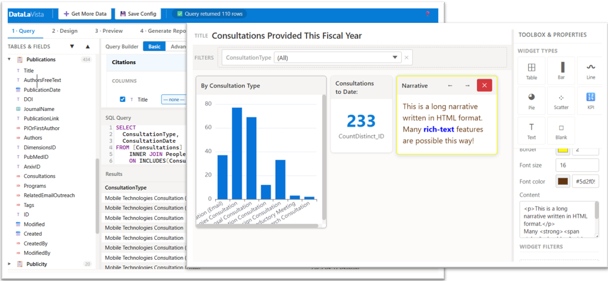

<!--
This file is part of DataLaVista™
docs/README.md
Author(s): Gabriel Mongefranco, Jeremy Gluskin, Shelley Boa.
Created: 2026-09-05
Last Modified: 2026-10-28
Summary: Help home: what DataLaVista does, the guides for using it, the answers pages, and the pages for developers and maintainers.
Notes: See README file for documentation and full license information.

Copyright © 2026 The Regents of the University of Michigan

Licensed under the GNU Free Documentation License v1.3 or later.
See <https://www.gnu.org/licenses/fdl-1.3.html>. See README for full license information.
-->

# DataLaVista™

## Help and documentation

DataLaVista™ is a free dashboard and reporting tool that runs entirely in your
web browser. You connect it to a SharePoint list or a data file, shape the data
with a visual query builder or with SQL, design charts and tables, and share the
finished dashboard with a link. There is no server to set up and no license to
buy. Your data stays in your browser and in the places it already lives, and the
permissions of those places still apply.

This page is the starting point for the help. The guides take you through each
step of building a dashboard. The pages at the end are for people who maintain
the code.

### Dashboard Development Steps

Every dashboard follows the same path through the four tabs of the designer:

1. Query. Connect to your data, pick tables and fields, join and reshape them,
   and check the result in the preview table.
2. Design. Place charts, tables, KPIs, and text on the canvas, add filters,
   and map your fields to each one.
3. Preview Dashboard. Look at the dashboard the way other people will see it,
   try the filters, and check the numbers.
4. Generate Report. Save the dashboard to a SharePoint library or to your
   computer, and share the link.

Getting the query right first makes the other steps faster. You can also change
the data source later and keep the same design.

### Guides

- [Local server](local-server.md): run DataLaVista on your computer with ZippyServe.

- [Get started](how-to/get-started.md): open the live demo, run DataLaVista from
  a file or inside another website, and build a first dashboard with sample data.
- [Install DataLaVista in SharePoint](how-to/install-in-sharepoint.md): upload
  one file to your site, add one page, and update it later.
- [Connect to data](how-to/connect-to-data.md): SharePoint lists, files on your
  computer, and files on the web, plus the extra fields DataLaVista adds for you.
- [Build a query](how-to/build-a-query.md): the query builder, the SQL editor,
  and the checks to make before you design.
- [Design a dashboard](how-to/design-a-dashboard.md): widgets, field mapping,
  totals and averages, and filters.
- [Preview a dashboard](how-to/preview-a-dashboard.md): what to check before
  you share, and how to download the data behind a chart.
- [Publish and share a dashboard](how-to/publish-and-share.md): save to
  SharePoint or to a file, the share link, and who can see what.

### Answers

- [Frequently asked questions](faq.md): what DataLaVista is good for, its limits,
  and where your data goes.
- [Troubleshooting](troubleshooting.md): what to do when a file does not load,
  a page stays blank, or the numbers look wrong.

### For developers and maintainers

- [Architecture](architecture.md): the pieces of the app and how data moves
  through them.
- [Repository maintenance](repository-maintenance.md): source files, library
  copies, the build, the tests, and how the website is published.
- [Compliance](compliance.md): the security and accessibility controls in the
  code today, and the known gaps.
- [Skill authoring examples](skill-examples.md): recipes for writing small
  skills for coding assistants.
- [Documentation template](https://github.com/DepressionCenter/datalavista/blob/main/docs/doc-template.md):
  the structure to copy for a new help page.
- [Third-party notices](../THIRD-PARTY-NOTICES.md): the libraries packed into
  DataLaVista and their licenses.
- [Project README](../README.md): the short description, credits, license, and
  citation on GitHub.
- [Project instructions](../AGENTS.md): the rules that contributors and coding
  assistants follow.

### Related resources

- [DataLaVista on GitHub](https://github.com/DepressionCenter/datalavista):
  the code, releases, and issue tracker.
- [DataLaVista knowledge base article](https://teamdynamix.umich.edu/TDClient/210/DepressionCenter/KB/ArticleDet?ID=15179):
  the entry in the EFDC Health Research Resource Library.
- [Eisenberg Family Depression Center open source hub](https://code.depressioncenter.org):
  other free tools from the center.
- [Mobile Technologies Core](https://depressioncenter.org/mobiletech): the team
  that supports DataLaVista.
- [Modern Script Editor web part](https://github.com/pnp/sp-dev-fx-webparts/tree/main/samples/react-script-editor):
  needed to add DataLaVista to a SharePoint page.
- [Automators Anonymous](https://github.com/DepressionCenter/AutomatorsAnonymous):
  the community of practice that helped build DataLaVista.
- [Overview of SharePoint lists](https://teamdynamix.umich.edu/TDClient/210/DepressionCenter/KB/Article/13784/Navigating-TrackMaster-Overview-of-SharePoint-Lists):
  an EFDC article on how SharePoint lists work.
- [News article about DataLaVista](https://michigan.it.umich.edu/news/2026/03/30/michigan-medicine-cop-develops-free-dashboard-tool-that-challenges-expensive-bi-platforms/):
  Michigan IT News, March 2026.

### Citation

If DataLaVista helps your research, please cite it: Mongefranco, Gabriel;
Gluskin, Jeremy; Boa, Shelley (2026). DataLaVista™. University of Michigan.
Software. [https://doi.org/10.5281/zenodo.19245606](https://doi.org/10.5281/zenodo.19245606)
