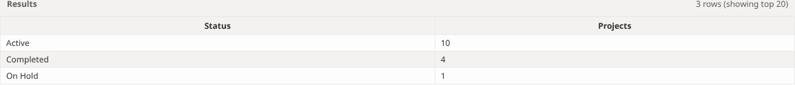
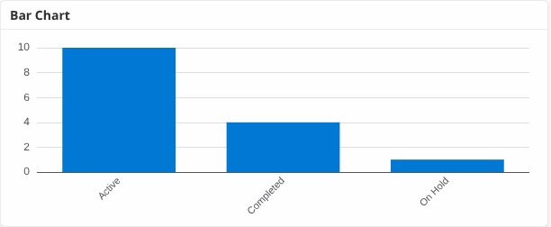

<!--
This file is part of DataLaVista™
docs/how-to/get-started.md
Author(s): Gabriel Mongefranco, Jeremy Gluskin, Shelley Boa.
Created: 2026-10-28
Last Modified: 2026-10-28
Summary: Explains how to open DataLaVista, where it can run, and how to build a first dashboard with sample data.
Notes: See README file for documentation and full license information.

Copyright © 2026 The Regents of the University of Michigan

Licensed under the GNU Free Documentation License v1.3 or later.
See <https://www.gnu.org/licenses/fdl-1.3.html>. See README for full license information.
-->

# DataLaVista™

## Get started

[Back to help home](../README.md)

This page shows you the quickest ways to open DataLaVista and walks you through
a first dashboard with sample data. It is for anyone who wants to try the tool
before installing it anywhere. You need a current web browser and about ten
minutes.

### Before you start

- A current browser, such as Edge, Chrome, Firefox, or Safari.
- Some data, or the sample files linked below. DataLaVista reads CSV, JSON, XML,
  Excel, and SQLite files, and SharePoint lists when it runs inside a
  SharePoint site.

There is nothing to install. DataLaVista is one web page, and everything it
needs is inside that page.

### Open the live demo

The quickest way to see DataLaVista is the demo on this website:

- [Project Health Dashboard](../../dist/DataLaVista.html?reportMode=view&report=https://code.depressioncenter.org/datalavista/samples/reports/Project%20Health%20Dashboard.json):
  a finished dashboard, the way people who receive a link see it.
- [Dashboard designer](../../dist/DataLaVista.html?reportMode=edit&report=https://code.depressioncenter.org/datalavista/samples/reports/Project%20Health%20Dashboard.json):
  the same dashboard open in the designer, so you can see how it was built.

The demo loads only the sample data on this website. Nothing you do in it is
saved unless you download it.

### Run DataLaVista on your own computer

1. Download [DataLaVista.html](../../dist/DataLaVista.html) and save it anywhere
   on your computer. In most browsers, right-click the link and choose
   **Save link as**.
2. Open the saved file in your browser, for example by double-clicking it.

Files you upload from your computer work right away. Files on the web only load
when the website that hosts them allows it, which the
[Connect to data](connect-to-data.md) guide explains.

### Add DataLaVista to a website

- For a SharePoint Online site, follow
  [Install DataLaVista in SharePoint](install-in-sharepoint.md). SharePoint
  lists on that site then appear as data sources.
- For another website or web application, host `DataLaVista.html` on your web
  server and show it in an `iframe`, or add the files the way your platform adds
  custom pages or scripts. The files are in the
  [dist folder on GitHub](https://github.com/DepressionCenter/datalavista/tree/main/dist).

### Your first dashboard

Build a bar chart that answers one question: **How many projects have each status?**
You will use 15 synthetic projects. Download the [projects CSV](../../samples/data/projects.csv)
and [DataLaVista.html](../../dist/DataLaVista.html) first. Once you have both files,
the exercise works offline. You do not need a SharePoint account.

1. **Load the projects.** Open the saved HTML file. Select **Connect + Load**,
   then **Upload Files**. Type `Demo` in **Data Source Name** *before* selecting
   **Browse…** and choosing `projects.csv`. Select **Connect & Load**.
   In **Tables & Fields**, expand **Demo**. You should see **Projects** with
   15 rows. The source and table together give you the SQL name `Demo_Projects`.
2. **Count projects by status.** On **Query → SQL Editor**, replace the existing
   query with the following and select **Run Query**:

   ```sql
   SELECT Status, COUNT(*) AS Projects
   FROM [Demo_Projects]
   GROUP BY Status
   ORDER BY Projects DESC
   ```

   Open **Results**. You should see three rows: **Active: 10**, **Completed: 4**,
   and **On Hold: 1**. Together they account for all 15 projects.

   

3. **Create the chart.** Select **Design**, then click **Bar** in the widget
   toolbox. With this query, the chart starts with **Status** on the X axis
   and **Projects** as the Y value, aggregated by **SUM**. Keep these settings:
   the query already counted the projects, so counting the three result rows
   again would give a bar of 1 for each status.
4. **Preview it.** Select **Preview Dashboard**. Compare the bars with your
   query results: Active should be tallest at 10, and On Hold shortest at 1.

   

5. **Save your dashboard.** Select **Generate Report**. When the report is
   ready, select **Save Local Copy** and keep the downloaded JSON file.
6. **Reopen and check it.** Open the saved HTML file in a fresh browser tab.
   Select **Connect + Load → Open Dashboard**, choose the JSON file under
   **Or upload a local dashboard file**, then select **Connect & Load**.
   Select **Preview Dashboard** again. The same three bars should appear
   without uploading the CSV again: the report includes the uploaded data.

### Conclusion

You can now open DataLaVista, load a file, and go from a query to a shared
dashboard. Read the guide for each step when you want more detail, starting with
[Connect to data](connect-to-data.md).

### Additional resources

- [Help home](../README.md)
- [Install DataLaVista in SharePoint](install-in-sharepoint.md)
- [Connect to data](connect-to-data.md)
- [Build a query](build-a-query.md)
- [Design a dashboard](design-a-dashboard.md)
- [Preview a dashboard](preview-a-dashboard.md)
- [Publish and share a dashboard](publish-and-share.md)
- [Project Health Dashboard demo](../../dist/DataLaVista.html?reportMode=view&report=https://code.depressioncenter.org/datalavista/samples/reports/Project%20Health%20Dashboard.json)
- [DataLaVista files on GitHub](https://github.com/DepressionCenter/datalavista/tree/main/dist)

[Back to help home](../README.md)
